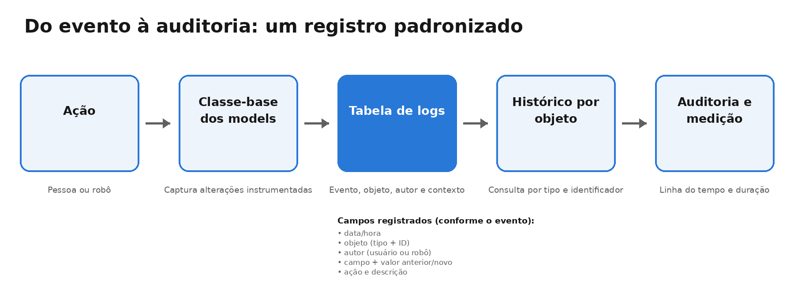
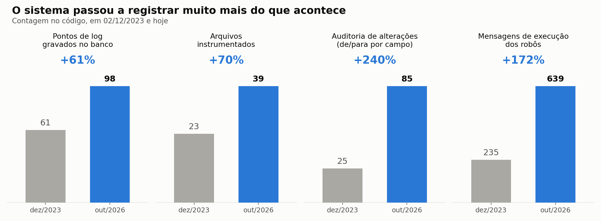
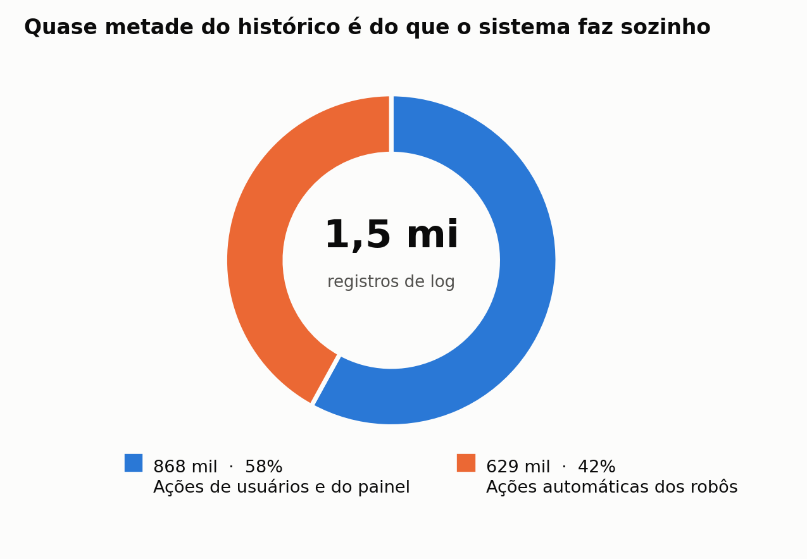
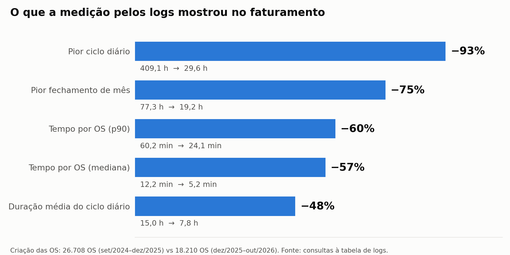
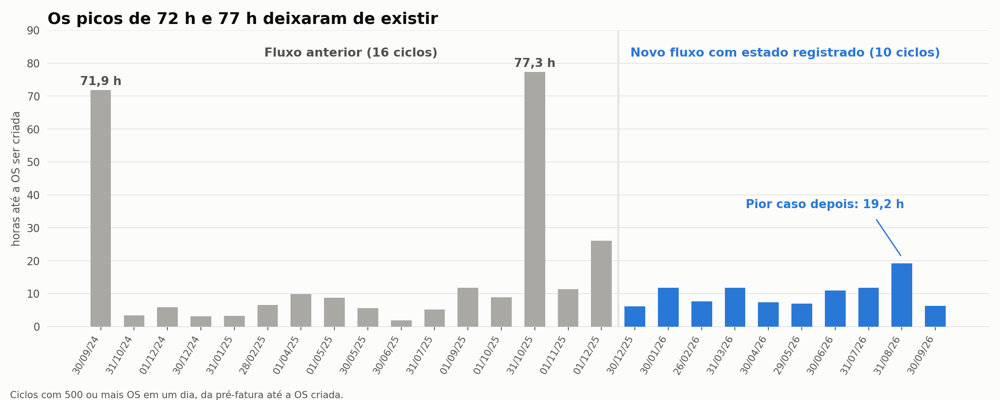

# Como ampliei a rastreabilidade de um sistema e passei a medir o faturamento pelos próprios logs

*Estudo de caso de engenharia de software · painel interno de operações e faturamento · dez/2023 a out/2026*

> **Nota de confidencialidade:** este material descreve uma experiência profissional. Antes de publicar, confirme com a empresa a autorização para divulgar os números, os períodos, as características da solução e qualquer trecho de código. Não publique nomes, dados de clientes, identificadores, estrutura interna ou informações operacionais sem autorização.



## Resumo executivo

Ampliei a instrumentação de um módulo de logs que já existia, mas era utilizado em poucos pontos e sem um formato comum. O trabalho padronizou o registro de alterações, diferenciou ações humanas de automações e permitiu consultar o histórico associado a cada objeto de negócio.

A evolução foi mensurável no código e em produção:

| Indicador | Dez/2023 | Out/2026 | Evolução |
|---|---:|---:|---:|
| Pontos de log gravados no banco | 61 | 98 | +61% |
| Arquivos instrumentados | 23 | 39 | +70% |
| Pontos de auditoria de alterações (de/para por campo) | 25 | 85 | +240% |
| Mensagens de execução dos robôs | 235 | 639 | +172% |
| Registros de log em produção | — | aproximadamente 1,5 milhão | — |

Além de melhorar a rastreabilidade, os logs passaram a permitir a reconstrução dos ciclos do faturamento. A mediana do tempo de criação por ordem de serviço caiu de 12,2 para 5,2 minutos (-57%). É importante separar os resultados: a redução de tempo veio da reescrita do fluxo de faturamento; a instrumentação de logs permitiu medir e demonstrar essa evolução.

## 1. O problema

O módulo de logs existia desde 2021, mas era utilizado em poucos pontos e não seguia um formato uniforme. Isso criava duas dificuldades:

- **Alterações com pouca rastreabilidade:** para descobrir quem havia alterado uma informação e qual era a diferença entre o valor anterior e o novo, muitas vezes era necessário reconstruir o cenário manualmente.
- **Automações com pouca visibilidade:** rotinas de faturamento e sincronização executavam sem acompanhamento direto e registravam pouco sobre as etapas realizadas. Quando ocorria uma falha, a investigação dependia de consultas e análise manual.

Em um sistema que trata contratos e receita, não conseguir reconstruir o que aconteceu é um problema operacional e de negócio, não apenas técnico.

## 2. A solução implementada

O trabalho foi organizado em quatro frentes:

1. **Padronização da auditoria na classe-base dos models.** Para as alterações que passam pelo mecanismo instrumentado, o sistema registra o campo alterado, o valor anterior, o novo valor, o autor e uma descrição legível. A centralização reduz a necessidade de repetir a implementação em cada módulo.
2. **Identificação das automações.** As execuções automáticas passaram a ser registradas sob uma identidade própria de usuário-robô, permitindo distinguir ações humanas de ações realizadas pelo sistema.
3. **Associação do log ao objeto de negócio.** Cada registro relaciona o evento ao tipo de objeto e ao identificador correspondente. Isso permite consultar o histórico de uma ordem de serviço, contrato ou cancelamento por um caminho padronizado.
4. **Ampliação da cobertura dos módulos.** Contratos, cancelamentos, revisão financeira, itens da OS, boletos e transições do faturamento passaram a registrar eventos no formato adotado. Foram realizados **66 commits** relacionados ao núcleo de logs.

### Visão simplificada do registro

Um evento de auditoria pode reunir, conforme o tipo de operação, informações como:

- data e hora;
- tipo e identificador do objeto afetado;
- autor (usuário ou robô);
- campo alterado;
- valor anterior e valor novo;
- ação e descrição contextual.

O trecho abaixo é ilustrativo e deve ser conferido contra o código autorizado para divulgação antes de ser publicado:

```php
// Exemplo simplificado de dados de auditoria por campo
$identifiers['ids'][$this->getKey()][] = [
    'field'               => $key,
    'old_value_field'     => $this->original[$key],
    'new_value_field'     => $field,
    'default_description' => $this->defaultDescription ?? '',
];

Log::channel('MysqlLog')->info($logMessage, $identifiers);
```

### Evolução do projeto

| Quando | Entrega registrada |
|---|---|
| mar/2024 | Usuário incluído no contexto do log e nova rota para consultar o histórico das alterações |
| abr/2024 | Logs de trocas de empresa e método de faturamento; consulta das alterações de um registro |
| set/2024 | Novo formato com descrição padrão para operações instrumentadas pela classe-base; inclusão de logs do financeiro |
| out/2024 | Logs de revisão financeira e contratos no formato padronizado |
| jan/2025 | Robôs de recebíveis e processamento de OS passam a registrar cada etapa |
| fev/2026 | Itens da OS passam a integrar o log da própria OS |

## 3. O que mudou no código e em produção



Os maiores avanços percentuais ocorreram nos pontos de auditoria de alterações (+240%) e nas mensagens de execução dos robôs (+172%) — justamente duas áreas que antes tinham pouca visibilidade.

Em produção, a tabela chegou a aproximadamente **1,5 milhão de registros**:



Desse total, aproximadamente 868 mil registros (58%) correspondem a ações de usuários e do painel, e 629 mil (42%) a ações automáticas dos robôs. Os números são arredondados conforme a visualização.

### Perguntas que passaram a ser respondidas

| Pergunta operacional | Informação disponível no histórico |
|---|---|
| Quem alterou este contrato e o que mudou? | Campo, valor anterior, valor novo, autor e data/hora, quando a alteração passa pelo mecanismo instrumentado |
| Uma alteração foi feita por pessoa ou por automação? | Identidade do autor e descrição da rotina registrada |
| Quanto tempo levou o ciclo de faturamento? | Carimbos de data/hora das transições de estado registradas |
| Em que etapa uma OS parou? | Último estado registrado para aquela OS |

## 4. O que os logs permitiram medir no faturamento

Esta seção exige uma distinção importante de causalidade: o fluxo de faturamento foi reescrito em um trabalho separado. Cada etapa passou a ter entrada, saída e estado registrados, em vez de depender de uma fila opaca. **A reescrita do faturamento foi responsável pela mudança de desempenho.** O trabalho de logs tornou possível reconstruir o ciclo e medir essa mudança com base nos carimbos de data/hora registrados.

A comparação apresentada considera 26.708 ordens de serviço do fluxo anterior (set/2024 a dez/2025) e 18.210 ordens de serviço do fluxo novo (dez/2025 a out/2026).



Os indicadores apresentados mostram:

| Indicador | Fluxo anterior | Fluxo novo | Variação aproximada |
|---|---:|---:|---:|
| Pior ciclo diário | 409,1 h | 29,6 h | -93% |
| Pior fechamento de mês | 77,3 h | 19,2 h | -75% |
| Tempo por OS (p90) | 60,2 min | 24,1 min | -60% |
| Tempo por OS (mediana) | 12,2 min | 5,2 min | -57% |
| Duração média do ciclo diário | 15,0 h | 7,8 h | -48% |

### Fechamentos de mês: menos casos extremos

Para essa análise, foram considerados ciclos com 500 ou mais OS em um dia, da pré-fatura até a OS criada. O gráfico apresenta 16 ciclos do fluxo anterior e 10 ciclos do fluxo novo.



O pior fechamento caiu de 77,3 para 19,2 horas (-75%). Os picos anteriores próximos de 72 e 77 horas não aparecem no conjunto do fluxo novo. **A mediana, porém, não diminuiu:** passou de 7,6 horas no fluxo anterior para 9,4 horas no novo, aumento de aproximadamente 24%. Portanto, o ganho observado nesse recorte está principalmente na redução dos casos extremos e na maior previsibilidade, não em uma melhora de todos os indicadores.

O pior ciclo diário é outro indicador, calculado sobre o conjunto diário mais amplo: caiu de 409,1 horas (cerca de 17 dias) para 29,6 horas (cerca de 1,2 dia). Não deve ser confundido com o pior fechamento mensal do gráfico acima.

## 5. Por que isso importa para o negócio

- **Observabilidade:** permite investigar posteriormente o comportamento das telas e automações a partir dos eventos registrados.
- **Rastreabilidade:** facilita identificar autoria e conteúdo de alterações instrumentadas em dados financeiros e contratuais.
- **Diagnóstico operacional:** ajuda a localizar a última etapa registrada quando uma rotina ou ordem de serviço não conclui o fluxo esperado.
- **Medição:** transforma os eventos registrados em uma fonte para reconstruir tempos e comparar ciclos operacionais.
- **Padronização:** reduz a duplicação de lógica ao concentrar o mecanismo comum na classe-base dos models.

A abrangência da auditoria depende de as operações passarem pelos caminhos instrumentados. Atualizações em massa, SQL direto ou outros caminhos que contornem o ciclo dos models precisam ser avaliados separadamente; não se deve presumir que toda alteração possível no banco gere automaticamente um evento.

## 6. Aprendizados

1. **Um formato comum facilita a investigação.** Quando os registros seguem uma estrutura consistente, consultas e telas de histórico podem ser reutilizadas entre módulos.
2. **Centralizar a regra reduz duplicação.** Colocar a lógica no ponto comum dos models diminui a dependência de cada módulo implementar sua própria auditoria — desde que a operação utilize esse mecanismo.
3. **Automações precisam de identidade.** Diferenciar pessoas e robôs melhora a interpretação do histórico.
4. **Logs podem apoiar decisões operacionais.** Além de investigar eventos, os carimbos de data/hora permitem medir etapas e ciclos de processos.

## 7. Metodologia, limites e pontos a validar

- As contagens de pontos de log, arquivos instrumentados e mensagens de execução foram obtidas pela comparação do código em 02/12/2023 com o código atual.
- O volume de registros em produção e os tempos de faturamento foram obtidos por consultas de leitura (`SELECT`) à tabela de logs.
- A comparação de faturamento considera períodos e volumes diferentes; não é um experimento controlado. Outras mudanças ocorridas no período também podem ter contribuído para os resultados.
- Antes de divulgar ou usar os números em uma apresentação externa, documente os critérios exatos de inclusão e exclusão das OS, o tratamento de registros incompletos ou sem timestamp, a definição de início e fim de cada ciclo e a fórmula usada para calcular mediana e p90.
- No recorte de fechamentos mensais, o gráfico apresenta 16 ciclos anteriores e 10 ciclos novos. A diferença no tamanho das amostras deve ser considerada na interpretação.
- Ainda não foi medido o tempo de investigação de incidentes antes e depois da instrumentação. Portanto, não é possível quantificar uma redução no tempo de resolução atribuível aos logs.
- A auditoria cobre as operações que passam pelos mecanismos instrumentados. É necessário verificar separadamente atualizações em massa, SQL direto e outros caminhos que possam contornar esses mecanismos.
